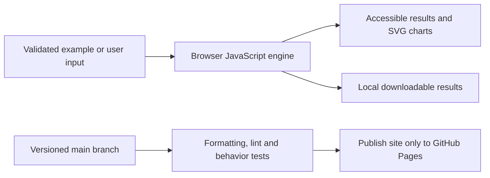

# Spendly

[Open the application](https://subhashdixit.github.io/spendly/) · [Report an issue](https://github.com/subhashdixit/spendly/issues)

A spec-driven expense-tracking learning project, extended into a usable HTML/JavaScript local expense workspace. The original Flask registration/login/profile prototype is preserved, while the Pages application completes expense CRUD without requiring a server account.

## What the finished application does

- Add, edit and delete expenses; filter by dates/categories and inspect totals.
- Save an exact integer-paise workspace in localStorage.
- Export/import validated JSON backups and explicitly clear local data.
- Try fictional records without exposing the original account database.

## Use the application step by step

1. Open the live application. Read the input labels and scope panel.
2. Start with the included example to understand the output.
3. Replace it with your own supported input. Files are processed locally unless you explicitly choose a server feature and consent to it.
4. Run the analysis and inspect the visual output together with its limitations.
5. Export your results when the tool offers a download. Keep your own copy; a browser tab is not a durable data store.

## Concepts, algorithms and interpretation

### Why a local workspace?

GitHub Pages serves static files and cannot run Flask or securely store server sessions. The maintained release uses a single-browser expense book, clearly labelled as local. This makes expense tracking usable on free static hosting without pretending that browser-local names/passwords create secure server accounts. The older Flask prototype remains in source for studying account architecture, but is not deployed by this workflow.

### Correct money and transactional state

Parse amount text into integer paise: INR 12.30 becomes 1230. Thus 0.10 + 0.20 becomes exactly 30 paise. Floating-point rupee sums can accumulate errors. Every record validates ID, date, category and bounds. An immutable ExpenseBook returns new state on update/delete. The UI persists that validated state before replacing its in-memory book; failed persistence is reported. A JSON import validates the entire set and duplicate IDs before asking to replace existing records. Totals are computed from the same filtered rows shown in the table.

### Spec-driven development

The release scope and acceptance criteria are in `.claude/specs/06-pages-expense-workspace.md`; its implementation plan is in `.claude/plans/06-pages-expense-workspace.md`. The original specifications/plans remain. Tests verify exact arithmetic, immutable CRUD, filtered totals, leap dates and rejected imports.

## Architecture and data flow



HTML provides the accessible page structure, CSS handles responsive layout, and ES modules separate calculation from user interaction. Pure calculation functions can run in Node tests without a browser. SVG charts scale with the screen; they use explicit axes, labels and legends. CSV exports escape spreadsheet formula prefixes in text cells.


## Run locally from scratch

Install Node.js 22 and Python 3 for a local static HTTP server. Python is not a production backend for this app.

```bash
git clone https://github.com/subhashdixit/spendly.git
cd spendly
npm ci
npm test
npm run lint
npm run format
npm run check
python3 -m http.server 8000 --directory site
```

Open http://localhost:8000. Use HTTP rather than double-clicking HTML so that module imports and local data fetches work consistently. No production API secret belongs in `site/`.

## Coding structure

```text
site/
  index.html       # accessible application interface
  styles.css       # responsive design
  app.js           # interface orchestration
  engine.js        # validated calculations; no DOM dependency
  ui.js            # chart, CSV and download helpers
tests/             # behavior and boundary cases
.github/workflows/pages.yml
archive/           # original README and retired workflows where present
```

Original source files, notebooks and historical artifacts remain in the repository for comparison. The release publishes only `site/`; old source directories and datasets are not automatically exposed by the application.

## CI/CD and deployment

CI means continuous integration: each pull request and main-branch push installs exact lockfile dependencies, checks formatting, lints JavaScript, runs meaningful behavior tests and checks module syntax. A failed check stops publishing. CD means continuous deployment: after the required `Build and test` check succeeds on `main`, GitHub Actions uploads `site/` and GitHub Pages serves it over HTTPS.

The workflow uses pinned action revisions, minimal permissions and a protected main branch. Publishing jobs need Pages/OIDC permissions; test jobs only read source. Feature branches are deleted after merge. Static Pages hosting needs no always-running Python process, but cannot hide secrets, host a Flask process or provide durable server storage.

To set up a fork, enable GitHub Pages with **GitHub Actions** as its source and allow the repository's workflow to run. Repository Settings → Pages shows the deployment URL. If renaming the repository, update the README URL and any absolute links; application resources use relative paths. Check Actions logs if publishing fails.

### Release, monitoring and rollback

A commit identifies exactly which source was deployed. Inspect the Actions deployment and test results before sharing the link. After publishing, open the page, run its example and check exports; a successful HTTP response alone is not a functional test. For rollback, revert the faulty merge in a new PR, pass checks, and merge the revert. This triggers the same reproducible publishing process. Avoid force-pushing protected main or deleting history. Browser caches can retain an older asset briefly; refresh after a deployment.

### Docker and alternatives

Docker packages code and dependencies into a reproducible runtime. This static app does not require a container: Pages serves the same versioned files directly, with less operating work and no container cold starts. A container becomes useful if adding a Python backend; then secrets, patches, resource costs and persistent storage require separate management.

## Data provenance and attribution

Original Spendly Flask source, specs and history preserved. The tracked original spendly.db stays outside site and is never copied into tests or release assets. All demo expenses are fictional.

## Practical limits

Browser localStorage is unencrypted, profile-specific and can be cleared by the browser. No cross-device sync, server login, durable cloud account or financial reporting guarantee. This app supports INR only. Keep exports and avoid shared browser profiles for private expenses. Up to 10,000 records and 16 MiB backup imports.

The test suite checks calculation contracts and invalid inputs. It cannot establish that an input dataset is representative, that a heuristic is scientifically correct for every domain, or that a result is suitable for an automated consequential decision. Read the original source alongside the maintained browser implementation when comparing behavior.
